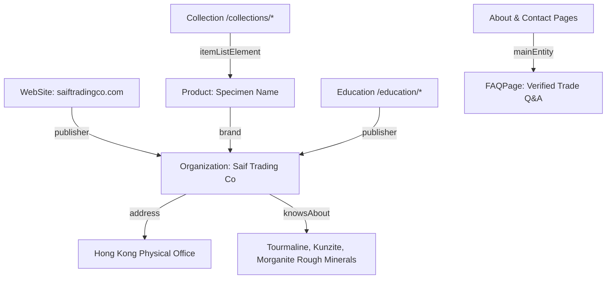

# Saif Trading Co — Comprehensive Production SEO & Entity Discoverability Audit

**Document Status:** Production Verified  
**Date:** March 2026  
**Client Project:** Saif Trading Co (`https://saiftradingco.com`)  
**Domain Authority Target:** Hong Kong Natural Rough Gemstone Supplier (Tourmaline, Kunzite, Morganite)  

---

## 1. Executive Summary & Audit Scope

This document provides the complete Technical SEO, Entity Search, Information Architecture, and AI Discoverability specification for **Saif Trading Co**. 

Saif Trading Co is a Hong Kong-based commercial supplier specializing strictly in natural rough gemstone crystals and mineral specimens. The website architecture and metadata are engineered to maximize organic search eligibility, entity resolution, and factual discoverability across Google Search, Google AI Overviews, and AI-assisted search engines (including OpenAI ChatGPT Search via `OAI-SearchBot`).

---

## 2. Technical SEO & Indexability Architecture

### 2.1 Public Crawl Matrix
| Route Pattern | Target Status | Indexability | Sitemap Inclusion | Structured Data |
| :--- | :---: | :---: | :---: | :--- |
| `/` | 200 OK | `index, follow` | Yes (Priority 1.0) | `Organization`, `WebSite` |
| `/collections` | 200 OK | `index, follow` | Yes (Priority 0.9) | `BreadcrumbList`, `ItemList` |
| `/collections/tourmaline` | 200 OK | `index, follow` | Yes (Priority 0.85) | `BreadcrumbList`, `ItemList` |
| `/collections/kunzite` | 200 OK | `index, follow` | Yes (Priority 0.85) | `BreadcrumbList`, `ItemList` |
| `/collections/morganite` | 200 OK | `index, follow` | Yes (Priority 0.85) | `BreadcrumbList`, `ItemList` |
| `/gemstones/[slug]` | 200 OK (or 404 if draft/hidden) | `index, follow` (only when public) | Yes (Priority 0.8 / 0.6) | `Product`, `BreadcrumbList` |
| `/education` | 200 OK | `index, follow` | Yes (Priority 0.8) | `BreadcrumbList` |
| `/education/[slug]` | 200 OK | `index, follow` | Yes (Priority 0.75) | `Article`, `BreadcrumbList` |
| `/certification` | 200 OK | `index, follow` | Yes (Priority 0.7) | `BreadcrumbList` |
| `/about` | 200 OK | `index, follow` | Yes (Priority 0.7) | `Organization`, `FAQPage`, `BreadcrumbList` |
| `/contact` | 200 OK | `index, follow` | Yes (Priority 0.8) | `ContactPage`, `FAQPage`, `BreadcrumbList` |
| `/admin/*` | 401 / 403 / Redirect | `noindex, nofollow` | **STRICTLY EXCLUDED** | None |
| `/api/*` | API Handlers | `noindex, nofollow` | **STRICTLY EXCLUDED** | None |

### 2.2 Canonical URL Governance
- **Canonical Host:** Strictly enforced as `https://saiftradingco.com` (no trailing slash on domain).
- **Environment Variable Fallback:** Configured in `lib/seo/metadata.ts` to default strictly to `https://saiftradingco.com` in production builds.
- **Query Parameter Isolation:** Dynamic collection filters (e.g., `?search=...`) specify `noIndex: true` when a query string is actively filtering results, preventing duplicate canonical dilution while canonicalizing back to the clean category URL (`/collections/[category]`).

---

## 3. Robots & Crawler Access Policy (`app/robots.ts`)

The `robots.txt` configuration explicitly permits search indexing crawlers and AI search systems to access public content while strictly safeguarding administrative and API routes.

```txt
User-agent: *
Allow: /
Disallow: /admin/
Disallow: /admin/*
Disallow: /api/
Disallow: /api/*

User-agent: Googlebot
Allow: /
Disallow: /admin/
Disallow: /admin/*
Disallow: /api/
Disallow: /api/*

User-agent: OAI-SearchBot
Allow: /
Disallow: /admin/
Disallow: /admin/*
Disallow: /api/
Disallow: /api/*

Sitemap: https://saiftradingco.com/sitemap.xml
```

### OAI-SearchBot & ChatGPT Search Eligibility
- `OAI-SearchBot` is explicitly permitted to crawl all public catalogue and educational routes.
- **Safety Rule:** Allowing `OAI-SearchBot` grants crawl accessibility for ChatGPT Search discovery; it does not claim or guarantee automated AI placement or recommendations.

---

## 4. Production Sitemap Safety Architecture (`app/sitemap.ts`)

### Critical Security & Data Integrity Rule
- **Zero Mock/Demo Leakage:** Demo gemstone fallback records are strictly eliminated from `app/sitemap.ts`.
- **Database Resilience:** If Supabase is unreachable or contains zero live published rows, the sitemap safely emits only verified static, collection, and educational routes (`publishedGemstones = []`).
- **Status Filter:** Only specimens with `status IN ('available', 'sold')` can ever be emitted. Any record marked as `draft` or `hidden` is excluded from both the sitemap and public page routing.
- **Timestamps:** Real `updated_at` / `created_at` database ISO timestamps are passed to `lastModified`.

---

## 5. Structured Data & Entity Schema Architecture

All JSON-LD schemas conform strictly to Schema.org standards, verified for Google Rich Results Test compatibility.



### 5.1 `Organization` Schema
- `@type`: `Organization`
- `@id`: `https://saiftradingco.com#organization`
- `name`: Saif Trading Co
- `legalName`: Saif Trading Co
- `url`: `https://saiftradingco.com`
- `address`: `417 Flat 4 Floor, Block B, Focal Industrial Centre, 21 Man Lok Street, Hung Hom, Kowloon, HK`
- `telephone`: `+852 3525 1640`
- `contactPoint`: Customer service & sales points covering Hong Kong and international trade.
- `knowsAbout`: `Rough Tourmaline`, `Rough Kunzite`, `Rough Morganite`, `Rough Gemstones`, `Mineral Crystals`, `Gemstone Documentation`.

### 5.2 `WebSite` Schema
- `@type`: `WebSite`
- `@id`: `https://saiftradingco.com#website`
- `publisher`: Reference to `#organization`
- `inLanguage`: `en-HK`

### 5.3 `Product` Schema (Factual Specimen Mapping)
- Used exclusively on `/gemstones/[slug]`.
- Includes `name`, `description`, `image`, `sku`, `category` ("Rough Tourmaline", etc.), `brand` (Saif Trading Co).
- **Offer Transparency:** Only includes an `Offer` block if a positive numeric price is configured in the database. If prices are private/trade inquiries, no fake offer is generated.
- **Stock Status:** Factual mapping between `InStock` (available) and `SoldOut` (sold).

### 5.4 `Article` Schema
- Used on `/education/[slug]`.
- Includes `headline`, `description`, `image`, `publisher` (Saif Trading Co), and `mainEntityOfPage`.
- **Integrity Rule:** Zero fabricated author personas.

### 5.5 `FAQPage` Schema
- Implemented on `/about` and `/contact` via `components/ui/FaqSection.tsx`.
- Contains 8 verified, fact-checked Q&As answering commercial location, mineral specialties, ordering process, and laboratory documentation policies.

---

## 6. Topical Clusters & Search Intent Architecture

```
CLUSTER 1: ROUGH TOURMALINE (Pillar: /collections/tourmaline)
├── Specimen Detail Pages (/gemstones/rough-*-tourmaline)
├── Guide: Tourmaline Crystal Formations (/education/tourmaline-crystal-formations)
├── Guide: Tourmaline Color Varieties & Inclusions (/education/evaluating-rough-gemstones)
└── Related Cross-Links: Rough Kunzite, Rough Morganite

CLUSTER 2: ROUGH KUNZITE (Pillar: /collections/kunzite)
├── Specimen Detail Pages (/gemstones/rough-*-kunzite)
├── Guide: Kunzite Pleochroism & Crystal Habits (/education/kunzite-pleochroism-and-care)
└── Related Cross-Links: Rough Tourmaline, Gemstone Certification

CLUSTER 3: ROUGH MORGANITE (Pillar: /collections/morganite)
├── Specimen Detail Pages (/gemstones/rough-*-morganite)
├── Guide: Morganite Beryl Hexagonal Morphology (/education/morganite-bicolors-and-phenomena)
└── Related Cross-Links: Rough Tourmaline, Trade Contact

CLUSTER 4: STANDARDS & AUTHENTICITY (Pillar: /certification)
├── Gemstone Laboratory Testing Guide (/certification)
├── Rough vs Cut Mineral Evaluation (/education/evaluating-rough-gemstones)
└── Verification & Inquiry Protocol (/contact)
```

---

## 7. Factual Client Entity Verification (NAP Consistency)

| Attribute | Verified Business Information |
| :--- | :--- |
| **Business Name** | Saif Trading Co |
| **Specialties** | Rough Tourmaline, Rough Kunzite, Rough Morganite |
| **Street Address** | 417 Flat 4 Floor, Block B, Focal Industrial Centre, 21 Man Lok Street |
| **District / Locality**| Hung Hom, Kowloon |
| **Territory / Country**| Hong Kong |
| **Office Telephone** | +852 3525 1640 |
| **Mobile Contacts** | +852 9064 9593 / +852 6903 7690 |
| **Official Email** | Saiftradingco@yahoo.com |

**Zero Fabrication Rule:**
No unverified years in business, awards, employee counts, fake review ratings, or fabricated overseas offices are introduced anywhere in code, schema, or content.

---

## 8. Google Search Console & Deployment Checklist

1. **Verification Tag:** `NEXT_PUBLIC_GOOGLE_SITE_VERIFICATION` is wired in `app/layout.tsx`. Ensure the verification string from Google Search Console is added to Hostinger / production `.env`.
2. **Sitemap Submission:** In Google Search Console, submit `https://saiftradingco.com/sitemap.xml`.
3. **URL Inspection:** Inspect the following URLs upon deployment:
   - `https://saiftradingco.com/`
   - `https://saiftradingco.com/collections`
   - `https://saiftradingco.com/collections/tourmaline`
   - `https://saiftradingco.com/collections/kunzite`
   - `https://saiftradingco.com/collections/morganite`
   - `https://saiftradingco.com/about`
   - `https://saiftradingco.com/certification`
   - `https://saiftradingco.com/contact`
4. **Rich Results Test:** Validate live structured data using the Google Rich Results Test tool. Verify that `Organization`, `WebSite`, `BreadcrumbList`, and `FAQPage` are recognized without errors.
